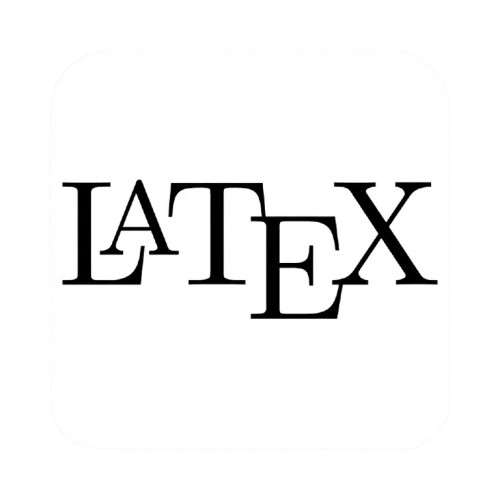

# [ITMO University](https://itmo.ru/)

# Оглавление
* [О репозитории](#description)
* [Факультет](#faculty)
* [Образовательная программа](#program)
* [Полезные ссылки](#links)

## О репозитории 
Этот репозиторий — мой личный архив учебных материалов, созданных и собранных за время обучения в Университете ИТМО.

**Основная цель проекта** — систематизировать учебные материалы, сохранить результаты проделанной работы и обеспечить удобный доступ к ним в будущем.

Репозиторий содержит лабораторные и домашние работы, конспекты лекций, учебные проекты и другие материалы, распределённые по семестрам и дисциплинам.

Проект находится в открытом доступе и может быть полезен как студентам ИТМО, так и всем любознательным. 

Материалы отражают мой личный опыт обучения и могут содержать ошибки или неточности.

## Факультет программной инженерии и компьютерной техники 

**Факультет программной инженерии и компьютерной техники (ФПИиКТ)** специализируется на подготовке специалистов по разработке компьютерных систем и новейших технологий программирования. Вектор развития факультета определяется прогнозом потребностей компьютерной и программной индустрии через 10-20 лет. На факультете готовят специалистов грядущей постинформационной эпохи – эпохи виртуальной реальности, киберфизических систем и интернета вещей.

## Образовательная программа «Системное и прикладное программное обеспечение» 

Программа готовит специалистов, которые разрабатывают сложные программные системы: от операционных систем и компиляторов до корпоративных информационных систем и высоконагруженных сервисов.

| Семестр | Предмет | Технологии и инструменты |
| :---: | --- | --- |
| 3 | [English C2 / Английский язык C2](./Семестр%2003/English%20C2%20%E2%80%94%20Английский%20язык%20C2/) |   |
| 3 | [Архитектура компьютера](./Семестр%2003/Архитектура%20компьютера/) |       |
| 3 | [Введение в технологическое предпринимательство](./Семестр%2003/Введение%20в%20технологическое%20предпринимательство/) |   |
| 3 | [Веб-программирование](./Семестр%2003/Веб%2Dпрограммирование/) |        |
| 3 | [Математический анализ](./Семестр%2003/Математический%20анализ/) |  |
| 3 | [Теория вероятностей](./Семестр%2003/Теория%20вероятностей/) |  |
| 3 | [Физика](./Семестр%2003/Физика/) |     |
| 3 | [Физическая культура и спорт (элективная)](./Семестр%2003/Физическая%20культура%20и%20спорт%20%28элективная%29/) |  |
| 3 | [Языки программирования](./Семестр%2003/Языки%20программирования/) |      |

# Полезные ссылки 

## Первокурсникам и абитуриентам

| Ссылка | Описание |
| --- | --- |
| [github.io/guide-for-applicants](https://yank0vy3rdna.github.io/itmo-faq/) | Гайд для абитуриентов |
| [github.com/Imtjl/1st-year-guide](https://github.com/Imtjl/1st-year-guide) | Гайд для первокурсников |
| [github.io/piikt-faq](https://e1turin.github.io/itmo-abit/faq) | Частые вопросы первокурсников |

## Сервисы университета
| Ссылка | Описание |
| --- | --- |
| [my.itmo.ru](https://my.itmo.ru/) | Главный учебный портал |
| [isu.ifmo.ru](https://isu.ifmo.ru/) | Общий портал (ИСУ) с полной информацией об учёбе |
| [se.ifmo.ru](https://se.ifmo.ru/) | Сайт заданиям к лабораторным работам |
| [bars.itmo.ru](https://bars.itmo.ru/) | Балльно-рейтинговая система |

## Учебные материалы, инструменты и репозитории
| Ссылка | Описание |
| --- | --- |
| [github.com/Imtjl/2nd-year-guide](https://github.com/Imtjl/2nd-year-guide) | Гайд для второкурсников |
| [BearIBear/BCOMP](https://github.com/BearIBear/BasicComputerExtExt) | Улучшенная синяя БЭВМ (поддержка macOS) |
| [1shayd1/ITMO](https://github.com/1shayd1/ITMO) [xelangel69/Labs-homeworks-and-etc](https://github.com/xelangel69/Labs-homeworks-and-etc) | Репозитории других студентов |
| [docs.google.com/spreadsheets/teachers](https://docs.google.com/spreadsheets/d/1TFTOKxqml1agwgo6Vp0Ql6Rgj9f9ciyOqQPF8VvUkJQ/edit?gid=591156939#gid=591156939) [docs.google.com/spreadsheets/teachers2](https://docs.google.com/spreadsheets/d/1wncYkv1fR64b7Y3Kk-fs3JnK4EUCwGZ7Bn7tJG5avz0/edit?gid=0#gid=0) | Таблицы с отзывами о лекторах и практиках (для выборности) |
| [205826.github.io](https://205826.github.io/) | Сборник полезных ссылок |
| [telegra.ph/useful-links](https://telegra.ph/Poleznye-ssylki-dlya-pervokursnikov-VT-08-26) | Второй сборник полезных ссылок |
| [notesitmo.github.io/cse-notes](https://notesitmo.github.io/cse-notes/first-course/firstcourse.html) | Конспекты для лабораторных работ |
| [vk.ru/kb_chess](https://vk.ru/kb_chess) | Объявления о шахматных онлайн-турнирах |

## Telegram-каналы
| Ссылка | Описание |
| --- | --- |
| [t.me/kb_esports_tg](https://t.me/kb_esports_tg) | Объявления о спартакиадах |
| [t.me/itmolnia](https://t.me/itmolnia) | Новостной канал для студентов |
| [t.me/vitmozasipashki](https://t.me/vitmozasipashki) | Засыпашки ИТМО (архив спящих студентов) |
| [t.me/itmoushen](https://t.me/itmoushen) | Подслушка ИТМО (андеграунд обсужденя) | 

---
*Проект вдохновлён [репозиторием Максима Барсукова](https://github.com/maxbarsukov/itmo)*
