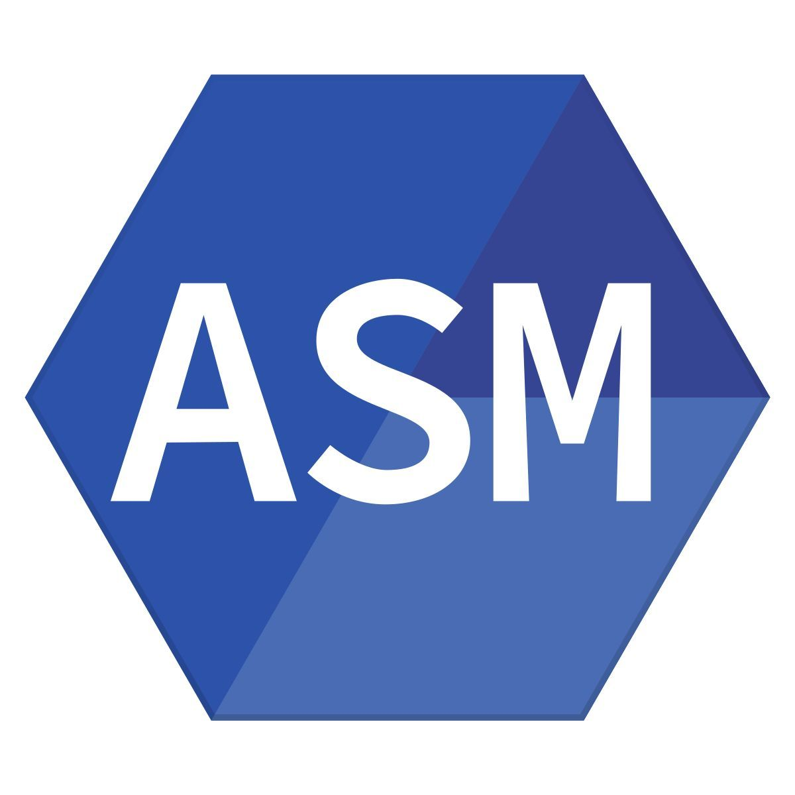

## Курс Программной инженерии
| Семестр | Предмет | Технологии и инструменты |
| :---: | --- | --- |
| 3 | English C2 / Английский язык C2 |   |
| 3 | Архитектура компьютера |  &thinsp;  &thinsp;     |
| 3 | Введение в технологическое предпринимательство |   |
| 3 | Веб-программирование |         |
| 3 | Математический анализ |  |
| 3 | Теория вероятностей |  |
| 3 | Физика |    |
| 3 | Физическая культура и спорт (элективная) |  |
| 3 | Языки программирования |      |
