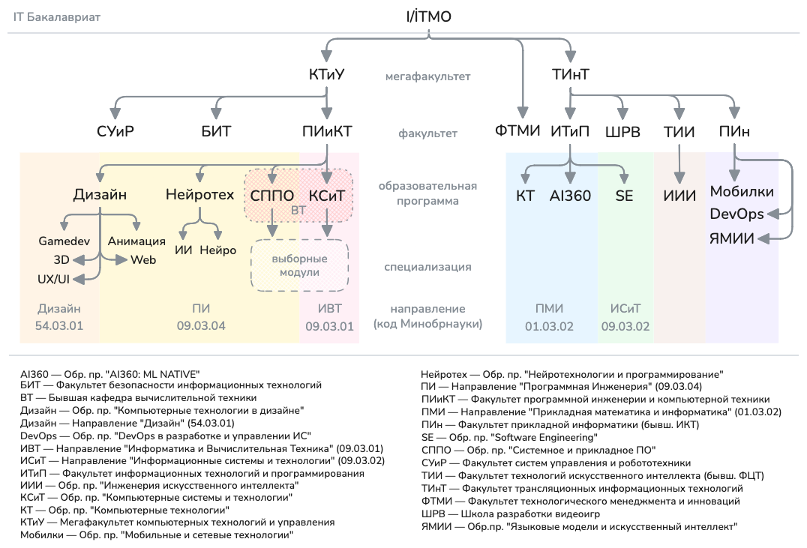

# ITMO University
## Образовательная программа «Программная инженерия»
| Семестр | Предмет | Технологии и инструменты |
| :---: | --- | --- |
| 3 | English C2 / Английский язык C2 |   |
| 3 | Архитектура компьютера |  &thinsp;  &thinsp;     |
| 3 | Введение в технологическое предпринимательство |   |
| 3 | Веб-программирование |         |
| 3 | Математический анализ |  |
| 3 | Теория вероятностей |  |
| 3 | Физика |    |
| 3 | Физическая культура и спорт (элективная) |  |
| 3 | Языки программирования |      |

---

## Полезные ссылки
| Ссылка | Описание |
| --- | --- |
| [BearIBear/BCOMP](https://github.com/BearIBear/BasicComputerExtExt) | Улучшенная синяя БЭВМ (поддержка macOS) |
| [1shayd1/ITMO](https://github.com/1shayd1/ITMO) | Репозитории талантливых студентов |
