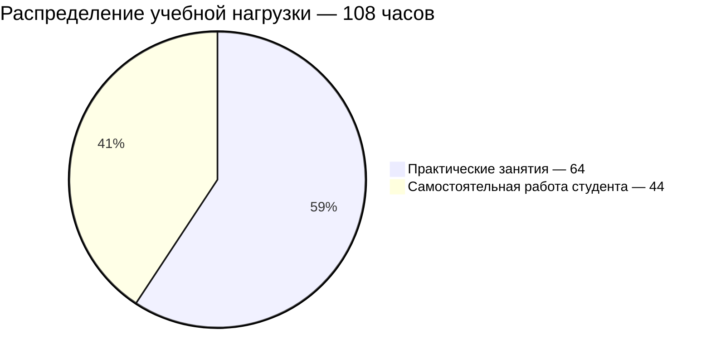

# [English C2 / Английский язык C2](https://my.itmo.ru/programs/53920)

**Практик:** [Данияли Сара](https://my.itmo.ru/persons/293927)

## О дисциплине

Рабочая программа курса разработана для всех образовательных программ бакалавриата Университета ИТМО. Целями освоения курса являются достижение уровня C2 в соответствии с Общеевропейской шкалой компетенций владения иностранным языком (CEFR), формирование и совершенствование англоязычной коммуникативной компетенции в сфере общего владения английским языком для решения социально-коммуникативных задач в различных областях культурной, бытовой сфер деятельности и обучении.

**Вид контроля:** Зачёт\
**Зачётные единицы:** 3