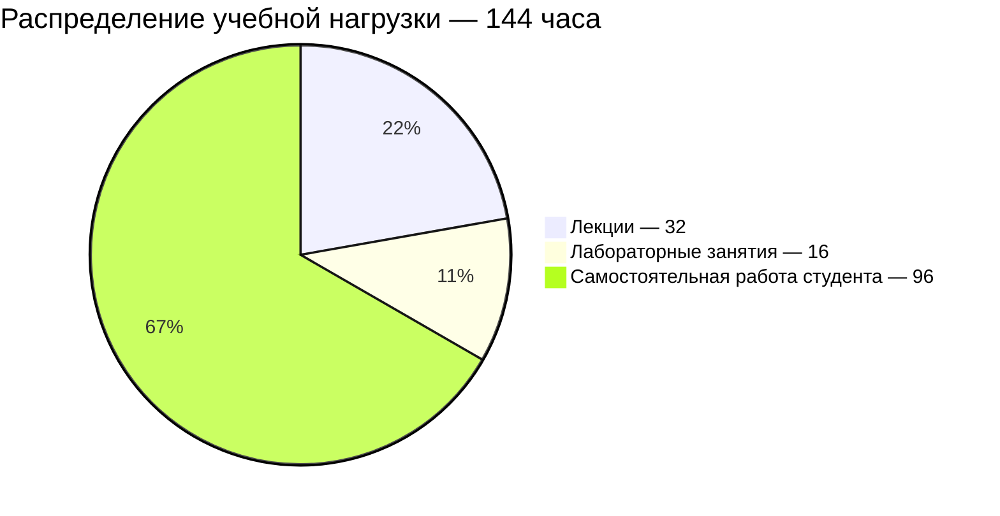

# [Архитектура компьютера](https://my.itmo.ru/programs/5917?p=mainRPD)
**Лектор:** [Пенской Александр Владимирович](https://my.itmo.ru/persons/142415)

**Практик:** [Горбачев Ярослав Георгиевич](https://my.itmo.ru/persons/172909)

## О дисциплине

Курс посвящен вопросам устройства вычислительных платформ -- базиса компьютерных систем, как они работают и какие возможности (сервисы) они предоставляют разработчикам компьютерных систем. Значительный акцент делается на том, как и почему они сформировались. Какие потребности определили те или иные вычислительные механизмы, какие из них получили путевку в жизнь, а какие стали бесполезным багажом обратной совместимости. С какими историческими параллелями, противоречиями и ляпами мы вынуждены мириться. Цель курса не объяснить, как надо делать компьютерные системы, а показать, как и по каким причинам мы пришли к тому, что мы имеем сегодня. Дать учащимся кругозор, отталкиваясь от которого они смогут угадывать устройство систем, с которыми работают; принимать проектные решения, имея видение области с разных точек зрения, а не только программисткой или аппаратной; самостоятельно прогнозировать дальнейшее развитие компьютерных систем и технологий. Вопросы непосредственного описания и разработки компьютерных систем остаются за пределами курса, как и глубокий анализ каждого из рассмотренных вариантов. Хороший разработчик -- это тот, кто умеет делать правильные предположения о том: - как устроены системы, с которыми он работает (сервисы, библиотеки, фреймворки, процессоры и т.п.); - как должны быть устроены системы, которые он делает; - к каким последствиям могут приводить принятые им решения; - какие «странности» можно ожидать и почему.

**Вид контроля:** Экзамен\
**Зачётные единицы:** 4

## Полезные ссылки

[Основной репозиторий курса](https://gitlab.se.ifmo.ru/computer-systems/csa-rolling)\
[Экзаменационные вопросы](https://gitlab.se.ifmo.ru/computer-systems/csa-rolling/-/blob/master/exam-questions-blitz.md)\
[Конспекты лекций](https://gitlab.se.ifmo.ru/computer-systems/csa-rolling/-/tree/master/course-note)\
[Проверка лабораторных работ](https://wrench.edu.swampbuds.me/submit-form)\
[Учебная платформа](https://slap-2026-2.edu.swampbuds.me/)\
[Симулятор процессора](https://github.com/ryukzak/wrench)
