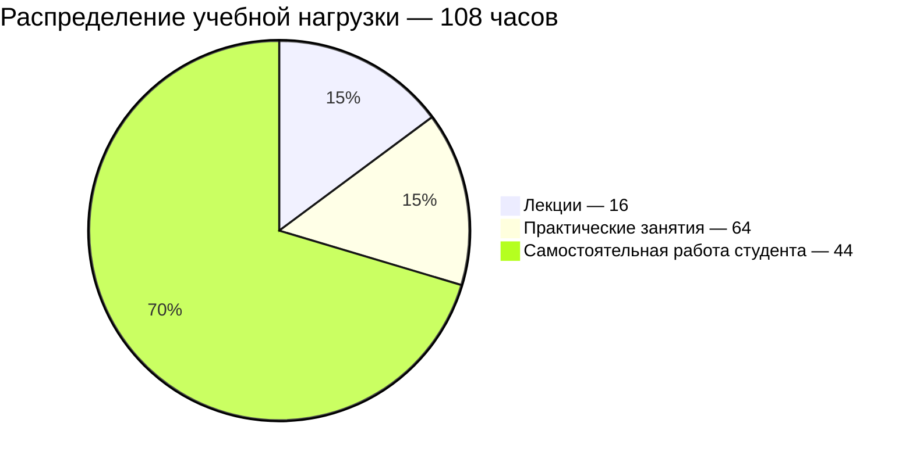

# [Введение в технологическое предпринимательство](https://my.itmo.ru/programs/59087)

**Лектор:** [Купоросов Юрий Игоревич](https://my.itmo.ru/persons/145893)\
**Практик:** [Купоросов Юрий Игоревич](https://my.itmo.ru/persons/145893)

## О дисциплине

Это единый курс для студентов всех специализаций Университета. Его цель состоит в развитии базового экономического мышления технологического лидера. Студенты познакомятся с основами предпринимательской культуры и процессами, лежащими в основе создания и развития инновационных бизнес-проектов, получат навыки анализа рынка и проектирования бизнес-моделей, а также сформируют понимание того, как идеи превращаются в устойчивые проекты. Каждая практика - это отработка инструмента создания технологического проекта в новых мини-группах и форматах. В финале студентам предстоит предложить и обосновать бизнес-идею в одной из исследованных на курсе технологических сфер и, возможно, получить помощь в ее реализации.

**Вид контроля:** Экзамен\
**Зачётные единицы:** 3