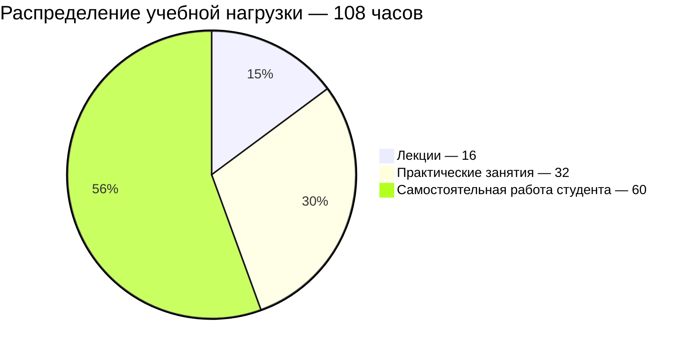

# [Веб-программирование](https://my.itmo.ru/programs/59550)

**Лектор:** [Егошин Алексей Васильевич](https://my.itmo.ru/persons/285578)\
**Практик:** [Ермаков Михаил Константинович](https://my.itmo.ru/persons/174292)

## О дисциплине

Целью дисциплины является изучение студентами базовых принципов построения приложений для сети Интернет и основ технологий, с помощью которых создаются такие приложения. В рамках дисциплины студенты должны освоить основные технологии разработки веб-приложений, а также получить практические навыки их разработки, развёртывания, тестирования и отладки.

**Вид контроля:** Экзамен\
**Зачётные единицы:** 3