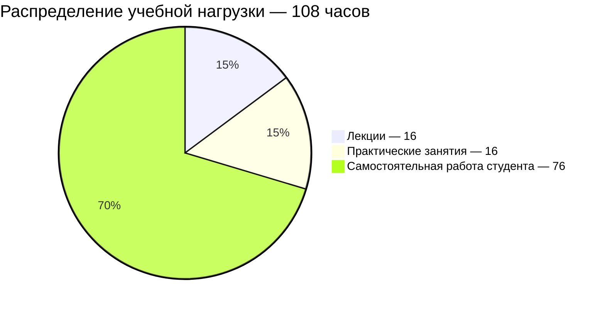

# [Теория вероятностей](https://my.itmo.ru/programs/18075)

**Лектор:** [Селина Елена Георгиевна](https://my.itmo.ru/persons/165442)\
**Практик:** [Селина Елена Георгиевна](https://my.itmo.ru/persons/165442)

## О дисциплине

Курс дает представление об основных понятиях и методах теории вероятностей. Целью освоения дисциплины является формирование у будущих IT-специалистов знаний и умения применять изучаемые методы при решении конкретных инженерных задач.

**Вид контроля:** Экзамен\
**Зачётные единицы:** 3