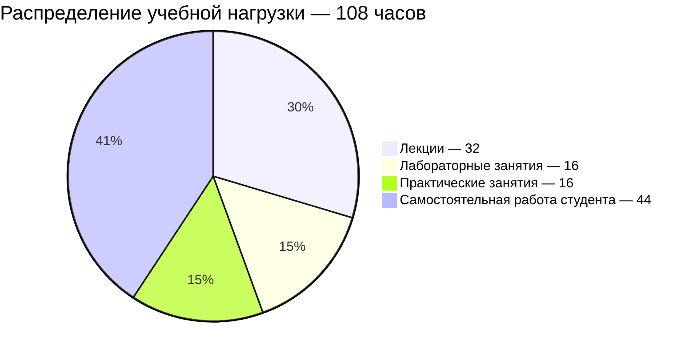

# [Физика](https://my.itmo.ru/programs/35651)

**Лектор:** [Сорокина Елена Константиновна](https://my.itmo.ru/persons/237368)\
**Практик:** [Рудель Алена Евгеньевна](https://my.itmo.ru/persons/274486)

## О дисциплине

Курс общей физики предназначен для бакалавров, специализирующихся в области IT широкого профиля. Цель курса - научить студентов использовать знания фундаментальных законов природы и основных законов физики для решения практических инженерных задач, анализировать результаты экспериментальных данных в рамках современных физических моделей.

**Вид контроля:** Экзамен\
**Зачётные единицы:** 3