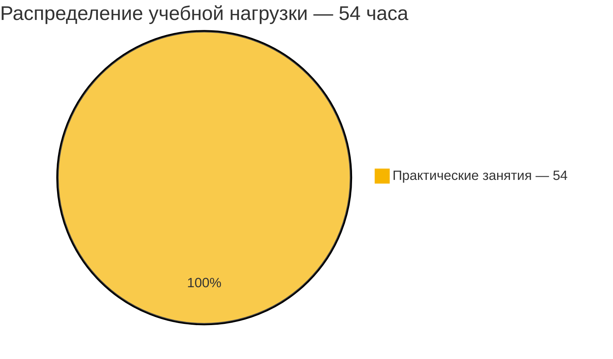

# [Физическая культура и спорт (элективная)](https://my.itmo.ru/programs/16560)

## О дисциплине

"Физическая культура" и "Физическая культура (элективная дисциплина)". Освоение дисциплины происходит в течение 6 семестров (1-3 курсы бакалавриата). Для получения зачёта в каждом семестре необходимо набрать 100 баллов. Баллы можно получить на тренировках спортивных секций, а также за спортивные достижения, участие в спортивных соревнованиях, спортивных сборах, специальных проектах. Подробнее о получении баллов можно прочитать в Памятке студенту.

**Вид контроля:** Зачёт\
**Зачётные единицы:** 0