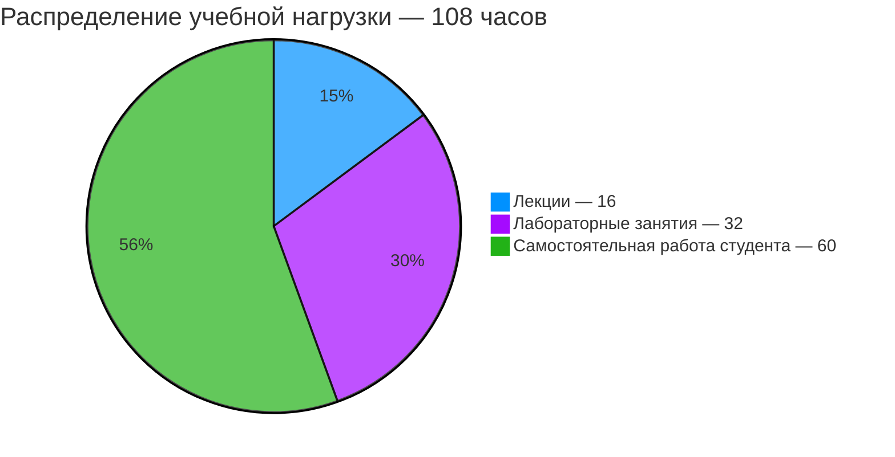

# [Языки программирования](https://my.itmo.ru/programs/16368)

**Лектор:** [Логинов Иван Павлович](https://my.itmo.ru/persons/157347)\
**Практик:** [Логинов Иван Павлович](https://my.itmo.ru/persons/157347)

# О дисциплине

Дисциплина "Языки программирования" изучает роль языков программирования в построении вычислительных систем, а также связь между языками и подходами к архитектурному проектированию программных и программно-аппаратных систем.

**Виды контроля:** Экзамен\
**Зачётные единицы:** 3

## Полезные ссылки

[Основной репозиторий курса](https://gitlab.se.ifmo.ru/programming-languages/cse-programming-languages-fall-2026/main)